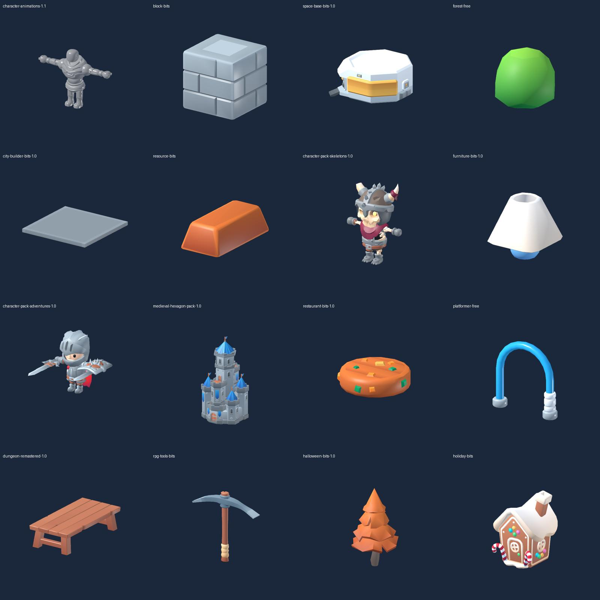
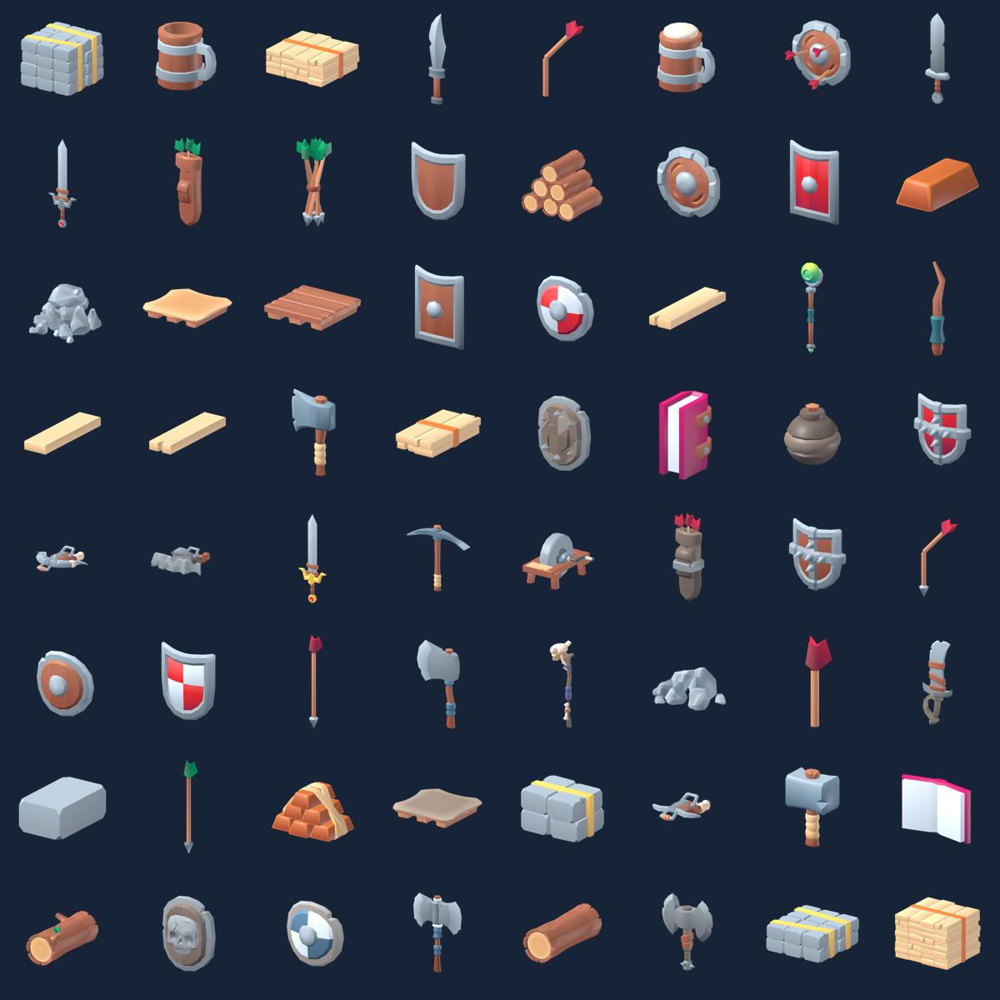
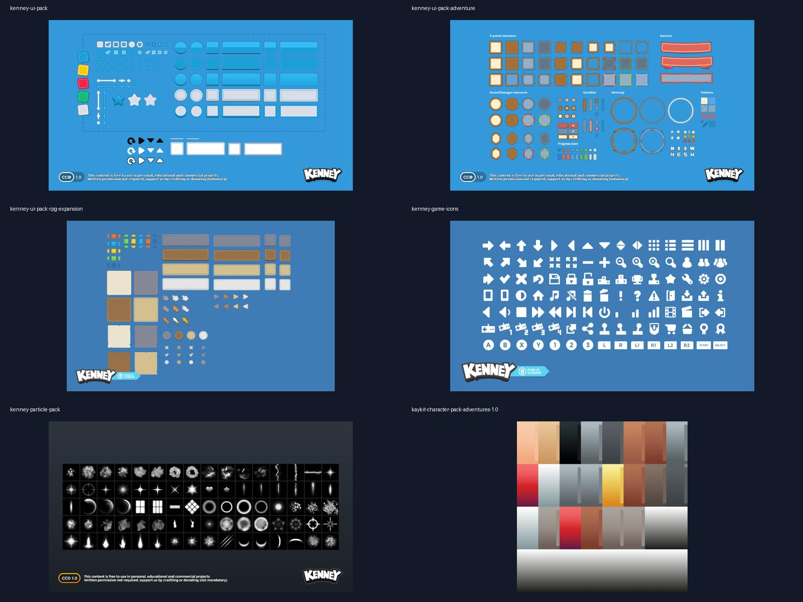

# Banque d’assets pour jeux — 55 packs gratuits

Fichiers réels, licences CC0 et catalogue pour Godot, Codex et Claude. **3 671 ressources 3D GLB/glTF** : modèles, accessoires et bibliothèques d’animations. Les variantes ne sont pas présentées comme des créations uniques.

- **16 packs KayKit gratuits** : personnages, squelettes, donjons, forêt, village médiéval, outils RPG, ressources, mobilier, restaurant, ville, espace, plateforme et collections saisonnières.
- **22 packs 3D Kenney** conservés : nature, véhicules, bâtiments, nourriture, pirates, terrain, science-fiction et autres décors.
- **Interfaces et boutons** : UI Pack, Adventure, RPG Expansion ; sources SVG disponibles, icônes et commandes clavier/manette.
- **64 icônes d’inventaire en PNG transparent 512 × 512**, rendues à partir des objets KayKit : armes, outils, boucliers et ressources.
- **562 fichiers audio** : interfaces, inventaire, RPG, impacts, sons numériques, science-fiction et jingles.
- **193 textures de particules** et **6 scènes VFX Godot** : impact, feu, soin, portail, butin et magie.

- **Dragon Evolved animé** : huit animations ; **trois œufs 3D sculptés** (feu, glace, émeraude). [Dragon](packs/quaternius-dragons/README.md) · [Œufs](packs/dragon-eggs-original/README.md)

## Aperçus et qualité

Sélection de modèles stylisés et d’interfaces nettes, sans packs pixel art. Les images conservent leur résolution d’origine ; les interfaces vectorielles permettent de changer l’échelle proprement. Le low poly est un style 3D, pas une image pixelisée. Block Bits convient aux jeux de construction à blocs ; il n’est pas la direction artistique principale d’un RPG fantasy.

Pour un beau jeu cohérent, commencer avec les personnages KayKit, Dungeon Remastered, Forest, Medieval Hexagon et RPG Tools. Utiliser UI Adventure/RPG et les icônes 3D associées. Ne pas mélanger toutes les catégories dans la même scène. Les mannequins du pack d’animations servent au rig et à la prévisualisation.

Vérifications : chargement dans Godot 4.3 de **1 585 nouvelles ressources 3D et 7 943 ressources média**, aucune erreur ; dépendances glTF et empreintes des fichiers contrôlées ; sons décodés ; rendus représentatifs des 16 packs KayKit et des 64 icônes inspectés. Les 2 082 modèles précédents restent vérifiés. La revue visuelle ne couvre pas chaque objet sous chaque angle. Les performances sur téléphone restent à mesurer dans le jeu final. Détails : [rapport](quality/report.json), [validation](validation.json).

## Utilisation

Ouvrir `project.godot` avec Godot 4.3, laisser l’import se terminer, puis glisser les modèles dans une scène. Copier seulement les packs nécessaires dans le jeu final en conservant textures, fichiers BIN et chemins relatifs. La banque complète n’est pas destinée à être intégralement embarquée dans un APK.

`catalog.json` contient `packs`, `models` et `assets`, avec chemins exacts, catégories, licences, empreintes SHA-256 et résultats d’import. Les modèles indiquent leurs triangles, animations et présence d’un squelette lorsque disponibles. Les médias sont indexés séparément ; les tailles, variantes et feuilles d’icônes ne correspondent pas à autant d’objets uniques.

Les animations KayKit sont organisées pour Rig Medium et Rig Large : choisir le rig compatible avec le personnage. Les 6 scènes dans `packs/godot-vfx-presets` nécessitent `kenney-particle-pack`. Leur méthode `play()` relance l’effet ; elles n’implémentent pas les dégâts ou les règles du jeu.

## Licences et provenance

Les packs inclus sont CC0, utilisables et redistribuables, y compris commercialement. Conserver les documents de licence et `SOURCE.json` pour retrouver leur provenance. Holiday Bits ne fournit pas de licence dans son archive : `LICENSE-SOURCE.md` conserve explicitement la déclaration CC0 de la page officielle. Les icônes d’inventaire sont des rendus des modèles KayKit ; leur fichier source est indiqué dans `seed/inventory-icons.json`.

Inclus : les versions gratuites vérifiées du catalogue KayKit. Exclus : Prototype Bits (greybox), les éditions payantes EXTRA/SOURCE et les packs pixel art. Ceci ne prétend pas inclure les collections payantes de l’auteur.

## Reproduction de la banque

Le workflow GitHub importe les archives officielles Kenney et les révisions KayKit figées sur GitHub. Les téléchargements gratuits itch.io et nos rendus sont conservés sous forme d’archives runtime dans `seed/archives`. Chaque fichier indexé est vérifié par empreinte avant publication. Aucun lien de téléchargement temporaire n’est nécessaire. `python3 scripts/populate.py` reproduit les fichiers et les rapports.
