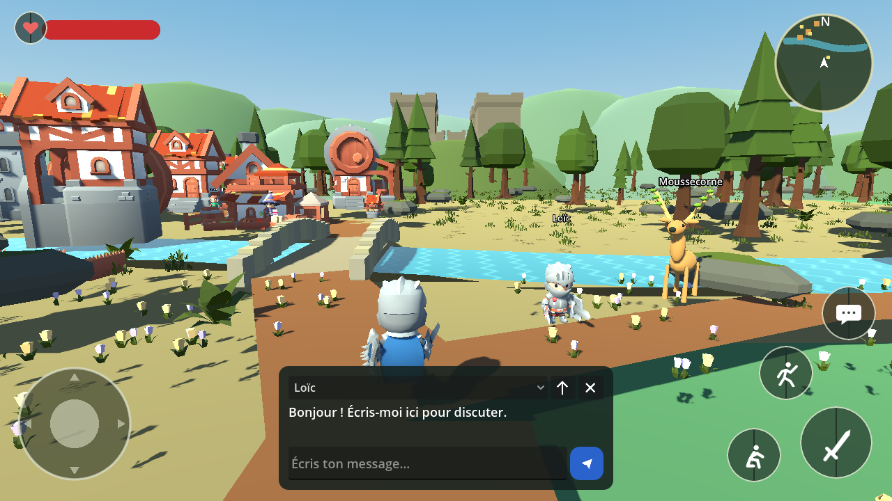

> **V0.4 Aurore** : caméra rapprochée derrière le joueur, village composé d’après la maquette, rivière et pont, commandes rondes et dialogue corrigé. Voir [ANDROID.md](ANDROID.md) pour l’installation et les limites vérifiées. Le rendu réel reste plus simple que la maquette illustrée.

# Loïc — monde vivant relié à Godot 4.3

**Version Android autonome V0.3 : [installation, commandes et limites](ANDROID.md).**
Qwen peut désormais fonctionner dans l’APK, sans ordinateur ni serveur.
Les instructions ci-dessous concernent principalement le lancement sur ordinateur.

Projet indépendant d’Yggdrasil, sur la branche `prototype-loic-monde-vivant`.
Ouvrir **le `project.godot` à la racine du dépôt** et appuyer sur F6/F5 :
la scène d’entrée est `res://loic/scenes/monde_loic.tscn`.
Le premier import des 55 packs peut prendre plusieurs minutes.



## Démarrer Godot et l’IA ensemble

Avec Python 3.9+ et Godot 4.3+ installés, sur **Linux x86_64** :

```sh
python3 loic/lancer_loic.py --godot /chemin/vers/Godot
```

Le lanceur télécharge le bundle Qwen3 0.6B déjà publié dans ce dépôt (~416 Mo),
vérifie les SHA-256 de l’archive et des poids, démarre llama.cpp en local,
puis ouvre Godot. Le modèle est partagé par le dialogue de Loïc, ses intentions
et le gestionnaire du monde. Le serveur lancé par le lanceur s’arrête avec le jeu.
Aucun compte ni clé API requis. Prévoir plusieurs Go de RAM.

Pour jouer sans télécharger ni lancer de modèle :

```sh
python3 loic/lancer_loic.py --sans-ia --godot /chemin/vers/Godot
```

Pour télécharger seulement : `python3 loic/lancer_loic.py --preparer-ia`.
Le téléchargement est mis en cache dans `.loic-runtime/`, exclu de Git et de l’import Godot.

Sur Windows ou macOS, on peut ouvrir le projet directement et utiliser les règles locales,
ou lancer un serveur llama.cpp adapté au système. **Le runtime fourni est Linux x86_64**.
L’endpoint par défaut est `http://127.0.0.1:8765/v1/chat/completions` ;
il est configurable par `LOIC_AI_ENDPOINT` ou `loic/ai_endpoint` dans les paramètres Godot.
Le serveur doit accepter les réponses JSON Schema pour les intentions.
La version Android native est décrite dans ANDROID.md ; aucun serveur hébergé n’est requis.

## Ce qui fonctionne

- Loïc : 24 ans, besoins, traits, mana, XP, mémoire persistante, dialogue libre avec Qwen,
  décisions personnelles et comportements de secours. Les clips déjà intégrés au vrai
  Knight KayKit sont utilisés ; les animations séparées supplémentaires ne sont pas retargetées.
- Monde : planificateur périodique, objectifs transmis à Qwen, propositions JSON limitées
  aux outils permis, coûts, disponibilité, maturité, limite de 120 éléments et placement
  conservant les deux axes routiers. Les règles poursuivent le développement si l’IA échoue.
- Élise et Garen : personnages KayKit visibles, affectation des travaux, déplacement
  avec évitement simple des bâtiments, animation disponible, durée de travail réelle,
  fatigue et repos. Une construction apparaît après arrivée et achèvement du travail.
- Nature : arbres qui poussent, cultures de blé en vrais modèles, récolte seulement à
  maturité, repousse après récolte, collecte du bois et extraction de pierre au site de carrière.
  La nourriture est consommée par la population ; planter ne produit pas instantanément des ressources.
- Catalogue : les **3 671 modèles des 55 packs** restent consultables ; les scènes sont
  chargées à la demande et partagées par un cache. Les licences et dépendances sont conservées.
- Vue : maison et puits KayKit, forêt, carrière, routes, monstres squelettes KayKit à la place
  de la sphère. Zoom à la molette, déplacement de caméra avec clic droit maintenu.
- Commandes : boutons de travaux, pause du monde, objectif en français validé par Entrée,
  dialogue de Loïc. Le panneau défile si nécessaire.

## Donner des yeux à l’IA

`WorldEyes.observe()` inspecte les **objets réels de la scène** autour du personnage,
avec distance et rayon de visibilité ; un rayon physique masque les objets derrière
les bâtiments possédant une collision. Les objets invisibles sont exclus.
Ce relevé alimente les décisions de Loïc et les rapports des ouvriers.
Le gestionnaire dispose aussi d’un état global : stocks, travaux, objets mûrs, population.

Le bouton « Observer » écrit le relevé dans `user://derniere_observation.json`.
Il s’agit d’une perception géométrique structurée, **pas d’un modèle de vision qui regarde
les pixels de la caméra**. Le petit Qwen livré est un modèle de texte.

## Autonomie et limites

Les IA proposent des intentions ; Godot les valide et exécute leurs conséquences.
Elles peuvent développer et entretenir le village avec ces outils, pendant que le programme
est ouvert. Elles **ne réécrivent pas les scripts du jeu**, ne téléchargent pas d’autres IA
et n’apprennent pas de nouveaux poids. Les milliers d’assets du projet source ne sont pas tous affichés
simultanément ; le planificateur utilise une palette cohérente sélectionnée dans la banque.
Le champ d’objectif influence Qwen ; le planificateur de secours suit ses propres priorités.

C’est une V1 de simulation : terrain plat, déplacement dirigé avec évitement simple
(plutôt qu’une navigation complète), population fixe, carrière abstraite sans épuisement,
récolte représentée par une repousse, pas de chantier visuel intermédiaire ni intérieur
jouable de la maison. Le sommeil est contrôlé par la proximité du point maison.
Loïc garde ses propres comportements ; les chantiers sont exécutés par Élise et Garen.
Les combats restent simulés et doivent encore recevoir portée, hitboxes et dégâts physiques.
Le modèle 0.6B peut produire des dialogues incohérents malgré une réponse structurée valide.
Aucune conscience subjective n’est établie par ces fonctions.

## Vérifier

```sh
# Après l’import par Godot, avec un dossier de données neuf pour chaque exécution :
LOIC_DISABLE_AI=1 XDG_DATA_HOME="$(mktemp -d)" godot --headless --path . --script res://loic/tests/test_world.gd
# Serveur Qwen démarré, données neuves également :
XDG_DATA_HOME="$(mktemp -d)" godot --headless --path . --script res://loic/tests/test_ai.gd
```

`test_world.gd` couvre 34 contrôles, dont 30 minutes simulées sans épuisement alimentaire,
les stocks non négatifs, les chantiers et la persistance. La même suite a été exécutée
avec le vrai rendu OpenGL sous Xvfb. Le moteur de rendu factice de Godot 4.3 peut afficher
`mesh_get_surface_count: Parameter m is null` lors de la libération de scènes importées ;
ces messages n’apparaissent pas dans la suite exécutée avec le rendu OpenGL.
Les résultats réels de cette version sont conservés dans `tests/validation_world.json`
et `tests/validation_qwen.json`. Ils ne prouvent pas la qualité générale du dialogue,
les performances sur téléphone ou une autonomie illimitée.
