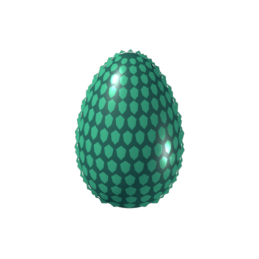
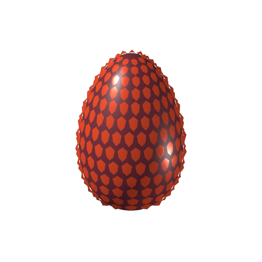
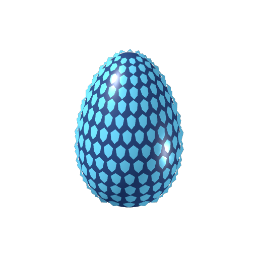

# Trois œufs de dragon 3D

Créations originales CC0 : Fire (rubis), Ice (bleu glacier), Emerald (jade). Coque lisse et plaques d’écailles en relief ; matériaux intégrés, aucune texture à chercher. Hauteur approximative 1,6 unité ; ajuster l’échelle selon le jeu.

GLB statiques testés et rendus dans Godot 4.3, 6 614 triangles par œuf. Pas d’animation d’éclosion, de collision ni de gameplay. Pour un inventaire, les aperçus PNG transparents 512 × 512 sont fournis. Le générateur reproductible est dans scripts/make_dragon_eggs.py.

