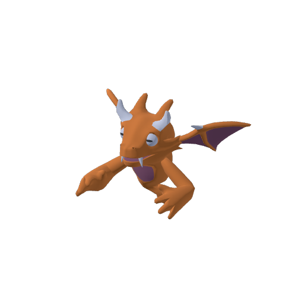

# Dragon Evolved — Quaternius

Dragon fantasy stylisé animé, glTF avec texture et squelette intégrés. Import testé dans Godot 4.3 ; aperçu réellement rendu dans Godot.

Animations présentes et lues pendant le test : Death, Fast_Flying, Flying_Idle, Headbutt, HitReact, No, Punch, Yes. Les contrôles de combat, navigation, collisions et souffle de feu ne sont pas inclus. Ne pas utiliser les animations humanoïdes KayKit pour ce squelette.

Copier le dossier et glisser Dragon_Evolved.gltf dans une scène. L’AnimationPlayer importé permet de sélectionner les clips. Le modèle est CC0 ; conserver LICENSE-SOURCE.md pour la provenance. Les performances sur téléphone restent à tester dans le jeu final.

